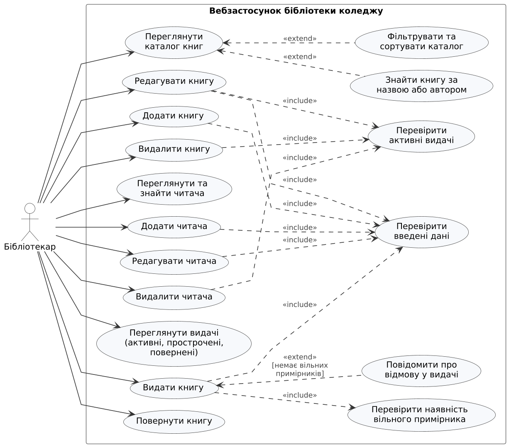
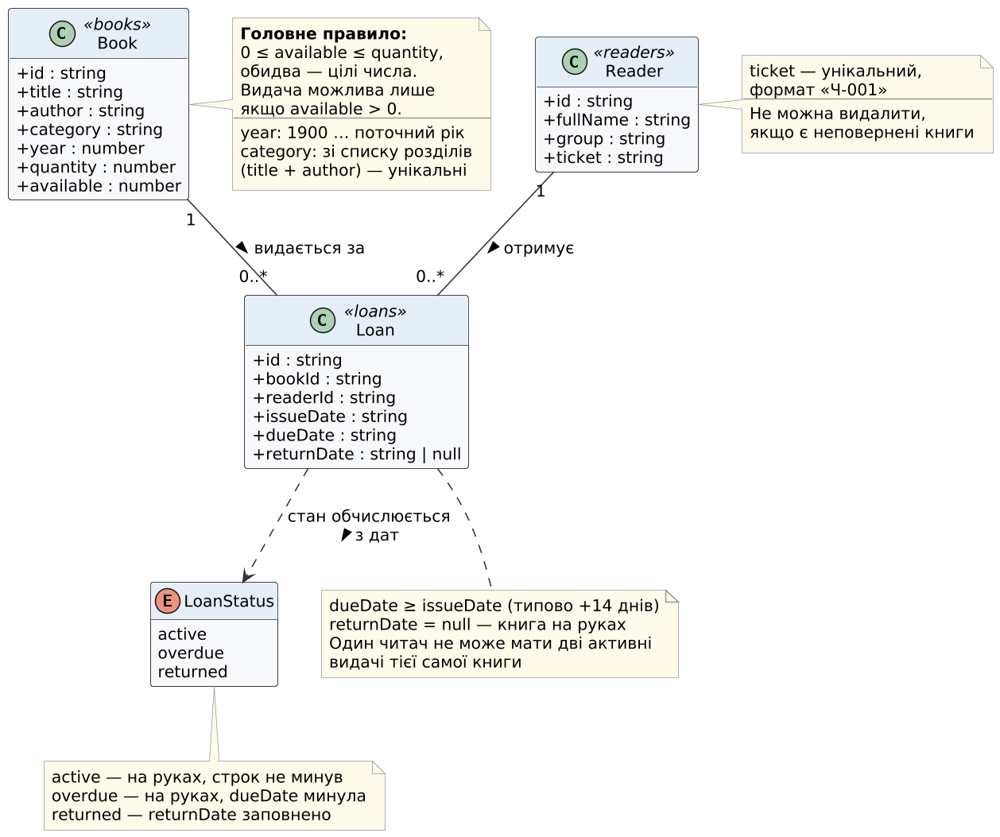
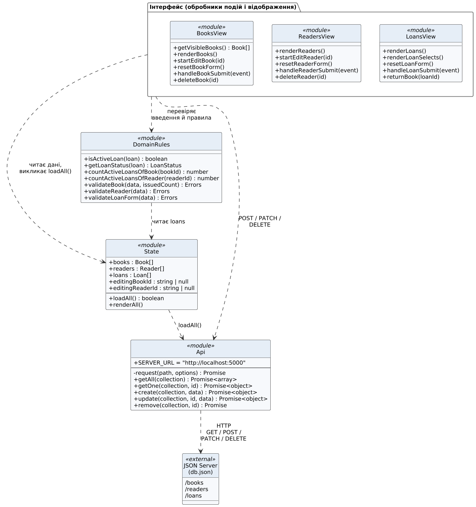

# Вебзастосунок обліку та видачі книг бібліотеки коледжу

Курсовий проєкт з дисципліни «Конструювання програмного забезпечення».

- **Тема:** 15. Бібліотека коледжу
- **Автор:** Турчак Богдан Богданович
- **Група:** ІС-23-01
- **Рівень складності:** ІІІ — Достатній (7–9 балів)

## Призначення

Вебзастосунок для бібліотекаря коледжу: облік книжкового фонду й читачів,
видача та повернення книг із перевіркою наявності вільного примірника.
Повна постановка завдання — у файлі [docs/task.md](docs/task.md).

## Функції

**Облік записів**
- перегляд, додавання, редагування та видалення книг;
- перегляд, додавання, редагування та видалення читачів;
- перевірка введених даних із повідомленням біля поля;
- збереження даних у `db.json` через JSON Server.

**Пошук, сортування, фільтрування**
- пошук книги за назвою або автором;
- сортування за назвою, автором, роком видання (за зростанням і спаданням);
- фільтр за розділом і «лише в наявності»;
- пошук читачів; пошук і фільтр видач: активні / прострочені / повернені.

**Основна операція — видача й повернення книги**
- видача книги читачеві з перевіркою, що є вільний примірник (`available > 0`);
- заборона повторної видачі тієї самої книги читачеві, який її ще не повернув;
- повернення книги з оновленням кількості доступних примірників;
- позначення прострочених видач.

**Головне правило:** книгу можна видати лише тоді, коли є вільний примірник;
кількість доступних примірників — ціле число від 0 до загальної кількості.

## Технології

- HTML, CSS, JavaScript (без фреймворків)
- [Node.js](https://nodejs.org/) LTS і npm
- [JSON Server 0.17.4](https://www.npmjs.com/package/json-server/v/0.17.4) — навчальний REST API на основі `db.json`
- [Live Server](https://marketplace.visualstudio.com/items?itemName=ritwickdey.LiveServer) — розширення VS Code для запуску сторінки
- Git — керування версіями

## Структура проєкту

```
course-project/
├── index.html            — розмітка сторінки та стилі (<style>)
├── app.js                — логіка: форми, перевірки, HTTP-запити до JSON Server
├── db.json               — дані: books, readers, loans
├── package.json          — налаштування npm і залежності (json-server)
├── package-lock.json     — точні версії залежностей
├── .vscode/settings.json — Live Server не перезавантажує сторінку при зміні db.json
├── docs/task.md          — постановка завдання
├── docs/uml/             — UML-діаграми (.puml — джерело, .png / .svg — зображення)
├── README.md
└── .gitignore
```

## UML-діаграми

**Діаграма прецедентів** — дії бібліотекаря в системі:



**Діаграма класів предметної області** — колекції db.json і зв'язки між ними:



**Діаграма класів структури app.js** — модулі програми та їхня взаємодія:



Діаграми створено в PlantUML; вихідні файли `.puml` лежать поруч із зображеннями.

## Запуск

Потрібно: Node.js LTS (разом із npm), VS Code з розширенням Live Server.

1. Відкрити папку `course-project` у VS Code (**File → Open Folder**).
2. Встановити залежності (один раз):
   ```
   npm install
   ```
3. Запустити JSON Server і не закривати термінал:
   ```
   npx json-server --watch db.json --port 5000
   ```
   Перевірка: http://localhost:5000/books — має відобразитися масив книг.
4. Відкрити `index.html` → правий клік → **Open with Live Server**
   (сторінка відкриється за адресою `http://127.0.0.1:5500`).

> Якщо JSON Server не запущено, сторінка показує повідомлення
> «Немає зв'язку з JSON Server…».

## HTTP-запити

| Дія | Метод | Адреса |
|---|---|---|
| Отримати всі книги | GET | `/books` |
| Отримати одну книгу | GET | `/books/1` |
| Додати книгу / читача / видачу | POST | `/books`, `/readers`, `/loans` |
| Змінити запис | PATCH | `/books/1`, `/readers/1`, `/loans/1` |
| Видалити запис | DELETE | `/books/1`, `/readers/1` |

## Стан розробки

- [x] Етап 1 — тема, функції, постановка завдання, початкові файли, навчальні дані
- [x] Етап 2 — середовище (Node.js, npm, JSON Server), реалізація всіх функцій
- [ ] Тестування та пояснювальна записка
