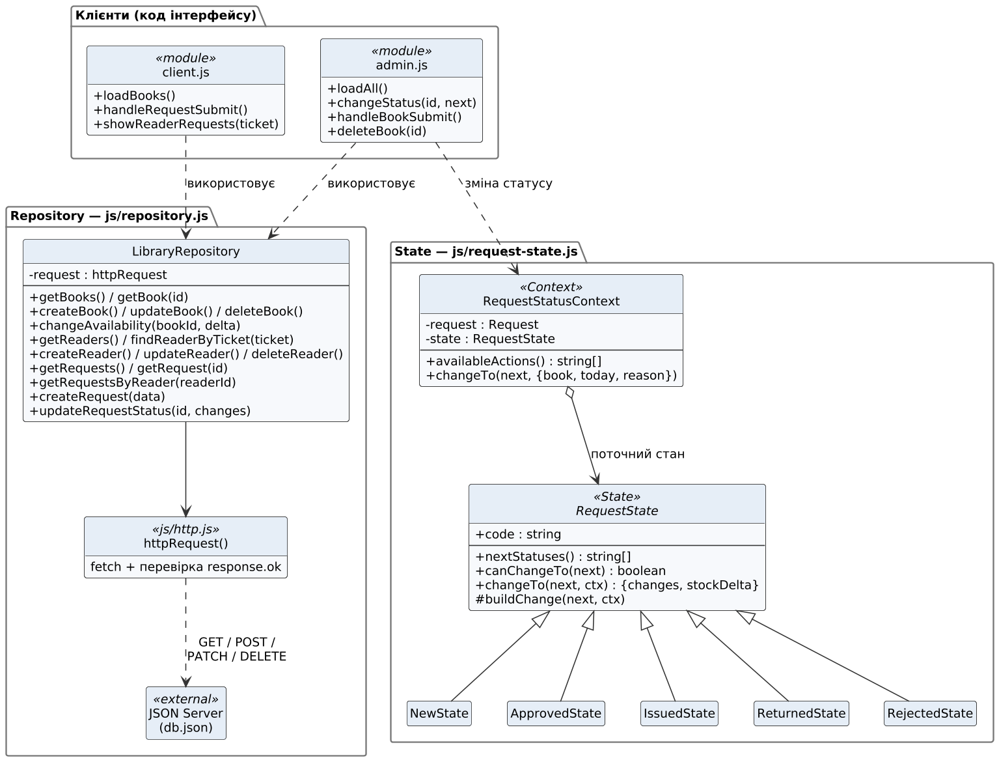

# Патерни проєктування: Repository і State

> **Етап 3 — проєктування.** Патерни погоджено й змодельовано. У коді етапу 3
> реалізовано операції читання Repository (`getBooks`, `getReaders`, `getRequests`,
> `getRequestsByReader`, `findReaderByTicket`). Операції запису й класи State
> реалізуються на етапі 4.

Учасники та зв'язки обох патернів показано на діаграмі [`docs/uml/patterns.png`](uml/patterns.png),
переходи статусів — на діаграмі станів [`docs/uml/request-states.png`](uml/request-states.png).

## 1. Repository — `js/repository.js`

**Проблема.** Обидві сторінки працюють з одними й тими самими даними через HTTP.
Якби кожна сторінка сама складала адреси й виконувала `fetch`, однаковий код
повторювався б, а зміна API зачепила б увесь інтерфейс.

**Рішення.** Клас `LibraryRepository` — єдиний шар операцій над сутностями.
Сторінки викликають предметні методи (`getBooks`, `createRequest`, `updateRequestStatus`)
і не знають ні адрес, ні HTTP-методів. Відображення HTML залишається в коді сторінок.

| Учасник | Файл | Роль |
|---|---|---|
| `LibraryRepository` | `js/repository.js` | Предметні операції над книгами, читачами, заявками |
| `httpRequest()` | `js/http.js` | Виконує `fetch`, перевіряє `response.ok`, перетворює помилки на `ApiError` |
| `API_URL` | `js/config.js` | Єдине місце з адресою JSON Server |
| Клієнти репозиторію | `js/client.js`, `js/admin.js` | Викликають методи й відображають результат |
| Джерело даних | JSON Server + `db.json` | Зберігає колекції `books`, `readers`, `requests` |

| Метод | HTTP-запит |
|---|---|
| `getBooks()`, `getBook(id)` | GET `/books`, GET `/books/:id` |
| `createBook(data)` | POST `/books` (`available = quantity`) |
| `updateBook(id, changes)` | PATCH `/books/:id` |
| `deleteBook(id)` | DELETE `/books/:id` |
| `changeAvailability(bookId, delta)` | GET `/books/:id` → перевірка `0 ≤ available ≤ quantity` → PATCH |
| `getReaders()`, `findReaderByTicket(ticket)` | GET `/readers`, GET `/readers?ticket=Ч-001` |
| `createReader`, `updateReader`, `deleteReader` | POST / PATCH / DELETE `/readers` |
| `getRequests()`, `getRequest(id)` | GET `/requests`, GET `/requests/:id` |
| `getRequestsByReader(readerId)` | GET `/requests?readerId=1` |
| `createRequest(data)` | POST `/requests` зі статусом `new` |
| `updateRequestStatus(id, changes)` | PATCH `/requests/:id` |

Функцію `httpRequest` передають у конструктор (`new LibraryRepository(httpRequest)`),
тому в автотестах її замінюють імітацією сервера без запуску JSON Server.

**Власний сценарій.** Читач подає заявку: `client.js` → `findReaderByTicket` →
`getBook` + `getRequestsByReader` → `createRequest` → POST `/requests`.

## 2. State (GoF) — `js/request-state.js`

**Проблема.** Заявка проходить шлях «нова → схвалена → видана → повернена» або
відхиляється. Від статусу залежить, які дії дозволені й як змінюється кількість
вільних примірників. Ланцюжок `if/else` у коді сторінки легко порушити й важко перевірити.

**Рішення.** Кожен статус — окремий об'єкт-стан, який знає дозволені переходи
й наслідки переходу. Контекст делегує йому зміну статусу.

| Учасник GoF | Клас | Роль |
|---|---|---|
| Context | `RequestStatusContext` | Тримає заявку й поточний стан; `availableActions()`, `changeTo(next, …)` |
| State | `RequestState` (абстрактний) | `nextStatuses()`, `canChangeTo()`, `changeTo()` → `{ changes, stockDelta }` |
| ConcreteState | `NewState` | → `approved` (лише якщо `available > 0`, `stockDelta = −1`), → `rejected` |
| ConcreteState | `ApprovedState` | → `issued` (`dueDate` = +14 днів), → `rejected` (`stockDelta = +1`) |
| ConcreteState | `IssuedState` | → `returned` (`stockDelta = +1`) |
| ConcreteState | `ReturnedState`, `RejectedState` | Кінцеві, переходів немає |
| Клієнт | `admin.js` → `changeStatus()` | Будує кнопки з `availableActions()`, застосовує результат через Repository |

Заборонений перехід або схвалення без вільних примірників — це `TransitionError`.
Сторінка показує її текст, і дані не змінюються.

**Власний сценарій.** Бібліотекар натискає «Схвалити»:

1. `admin.js` бере актуальну заявку й книгу з сервера (`getRequest`, `getBook`).
2. `new RequestStatusContext(request).changeTo("approved", { book, today })` →
   `NewState` перевіряє `available > 0` і повертає
   `{ changes: { status: "approved", decisionDate }, stockDelta: −1 }`.
3. Repository: `changeAvailability(bookId, −1)` і `updateRequestStatus(id, changes)` (PATCH).
   Якщо другий запит не вдався, кількість примірників повертається назад.

## 3. Як патерни працюють разом

State вирішує, **що** можна зробити і які поля змінити. Repository вирішує, **як**
зберегти зміни на сервері. Код сторінки лише показує кнопки й повідомлення.

## 4. Перевірка патернів

Позитивні й негативні перевірки обох патернів заплановано на етап 5.
