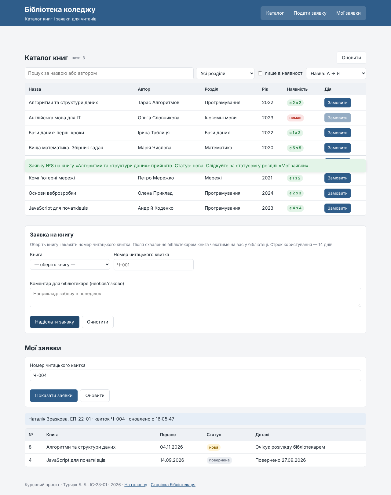
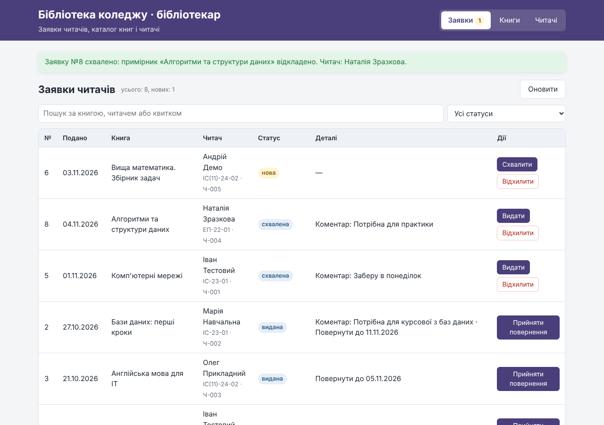
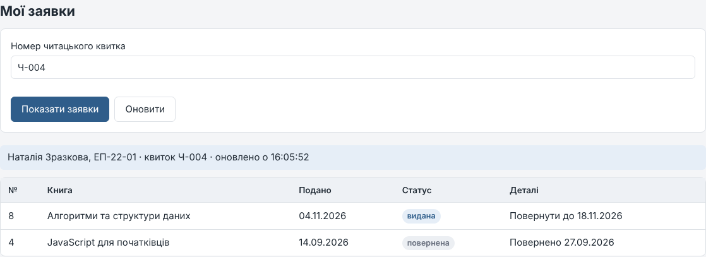
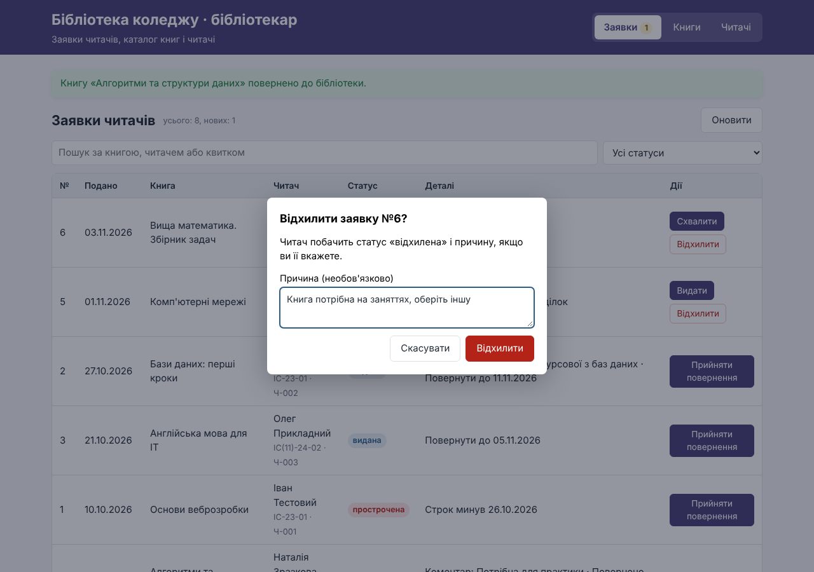
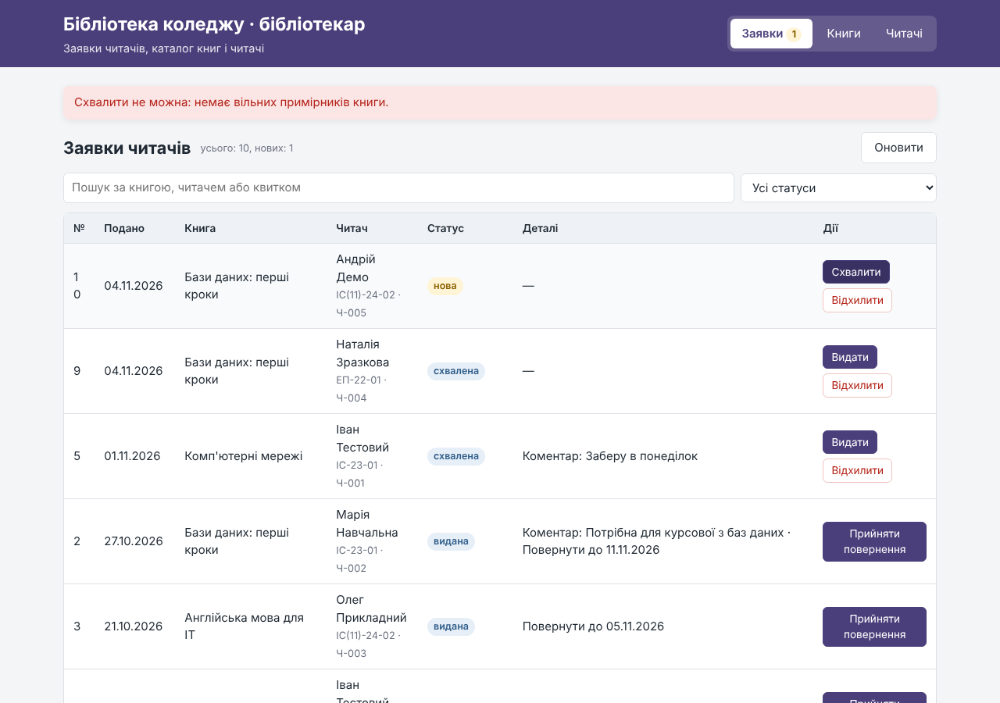
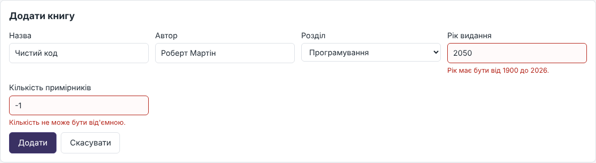
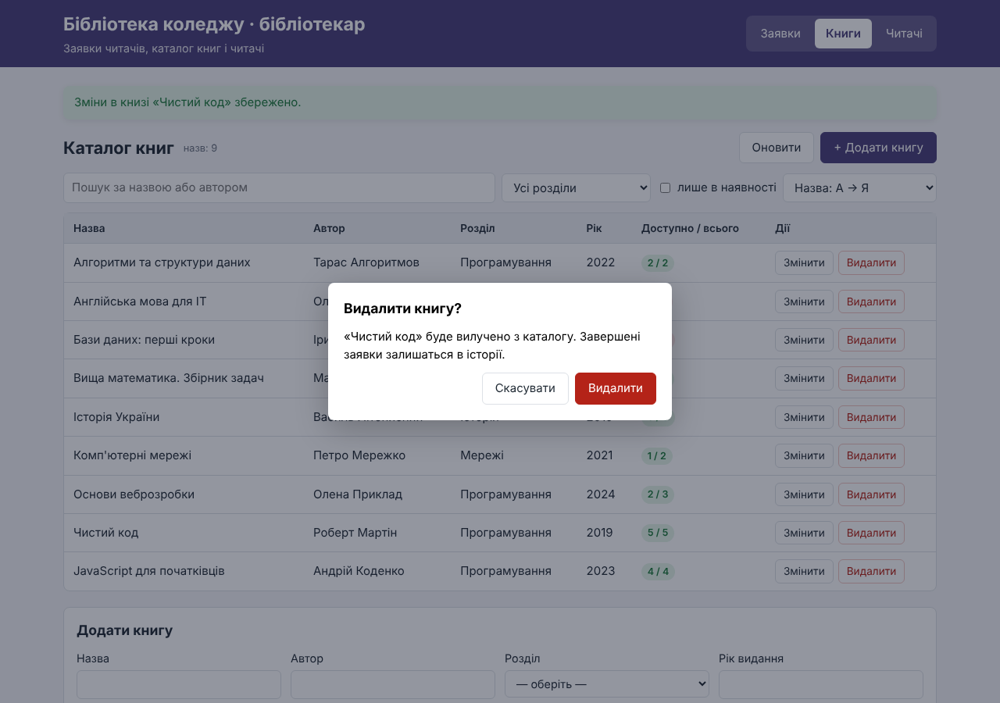
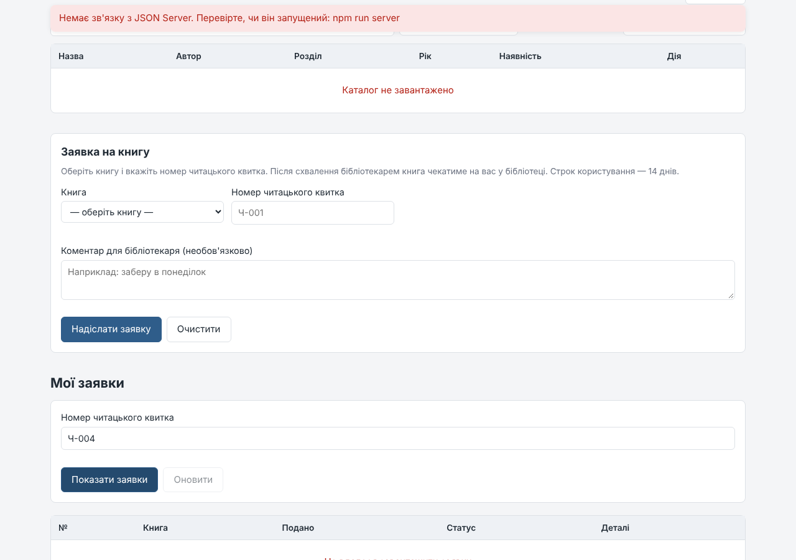

# Етап 4 — докази роботи через API

Перевірено 04.11.2026 на версії 0.4.0: JSON Server 0.17.4 (`npm run server`), сторінки
відкрито через HTTP-сервер. Наскрізний сценарій: читач створює заявку → бібліотекар
бачить її й змінює статус → читач натискає «Оновити» й бачить новий статус.

## 1. Читач створює заявку (POST)

Читач з квитком `Ч-004` обирає «Алгоритми та структури даних» і надсилає заявку.
Підтвердження з'являється лише після відповіді сервера, статус — «нова».



Запити сторінки читача (вкладка Network):

```
GET  /readers?ticket=Ч-004      — читач існує?
GET  /books/8                   — є вільний примірник?
GET  /requests?readerId=4       — немає незавершеної заявки на цю книгу, ліміт 3
GET  /requests                  — наступний номер заявки
POST /requests                  — створення заявки №8 зі статусом "new"
GET  /readers?ticket=Ч-004
GET  /requests?readerId=4       — оновлення блоку «Мої заявки»
```

## 2. Бібліотекар бачить заявку й схвалює її (PATCH)

Після «Оновити» заявка №8 є в переліку. «Схвалити»: патерн State перевіряє перехід
`new → approved` і `available > 0`, Repository резервує примірник і зберігає статус.



```
GET   /requests/8               — актуальний статус заявки
GET   /books/8                  — актуальна кількість примірників
GET   /books/8
PATCH /books/8                  — {"available": 1}   (було 2)
PATCH /requests/8               — {"status": "approved", "decisionDate": "2026-11-04"}
```

## 3. Видача та статус у читача

«Видати»: `PATCH /requests/8` → `{"status": "issued", "issueDate": "2026-11-04", "dueDate": "2026-11-18"}`.
Читач натискає «Оновити» (`GET /requests?readerId=4`) і бачить «видана, повернути до 18.11.2026».



Повернення: `PATCH /books/8` → `{"available": 2}`, `PATCH /requests/8` → `{"status": "returned", …}`.

Збережений запис у `db.json` після сценарію:

```json
{
  "id": "8",
  "bookId": "8",
  "readerId": "4",
  "comment": "Потрібна для практики",
  "status": "returned",
  "createdAt": "2026-11-04",
  "decisionDate": "2026-11-04",
  "issueDate": "2026-11-04",
  "dueDate": "2026-11-18",
  "returnDate": "2026-11-04",
  "rejectReason": null
}
```

## 4. Відхилення з причиною та заборонений перехід (State)

Відхилення підтверджується в діалозі; причину бачить читач.



Дві заявки на книгу з одним вільним примірником: першу схвалено, друга отримує відмову
«Схвалити не можна: немає вільних примірників книги.» — жодного PATCH не надіслано.



## 5. Керування книгами (POST, PATCH, DELETE)

```
POST   /books      — «Чистий код», 2 прим. → id "9", available 2
PATCH  /books/9    — quantity 5 → available 5
DELETE /books/9    — після підтвердження в діалозі
```

Невалідні дані (рік 2050, кількість −1) не надсилаються — помилки біля полів:



Видалення — лише після підтвердження. Книгу «Основи веброзробки», яку зараз видано читачу,
видалити не можна: «Не можна видалити «Основи веброзробки»: незавершених заявок — 1».



## 6. Недоступний сервер

JSON Server зупинено — обидві сторінки показують «Немає зв'язку з JSON Server…»,
таблиці — «не завантажено», повідомлення про успіх немає.


